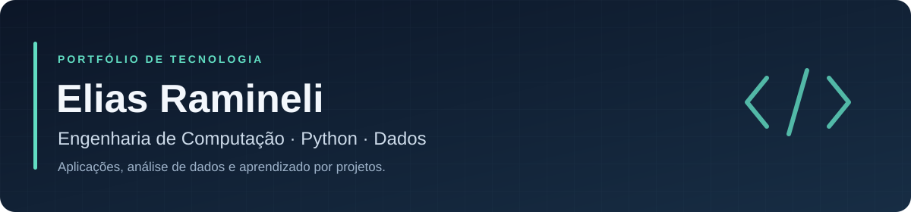

Sou estudante de **Engenharia de Computação** e construo meu portfólio com projetos de desenvolvimento Python, análise de dados e aprendizado de máquina.

Minha experiência anterior em e-commerce inclui análise de vendas, acompanhamento de indicadores e operações em marketplaces. Hoje, aprofundo minha formação técnica por meio de estudo e prática.

## Foco de desenvolvimento

- **Aplicações em Python:** organização de código, orientação a objetos, persistência e testes automatizados.
- **Análise de dados:** preparação de bases, consultas SQL, exploração e visualização de informações.
- **Aprendizado de máquina:** estudos de classificação, regressão e avaliação de modelos.
- **Formação complementar:** Java, C++, HTML, CSS e JavaScript.

## Projetos em destaque

| Projeto | Proposta | Tecnologias |
| --- | --- | --- |
| [**OrigemIA**](https://github.com/eliasramineli-sys/origem-ia) | Aplicativo local experimental para investigar indícios de geração por IA em fotos e quadros de vídeos, com relatórios e limites explícitos. | Python, OpenCV, PyTorch, Transformers |
| [**Previsão de vitória em League of Legends**](https://github.com/eliasramineli-sys/Previsao-de-Vitoria-em-Partidas-Ranqueadas-de-League-of-Legends) | Estudo de classificação com estatísticas de partidas, análise exploratória e comparação de modelos. | Python, Pandas, Scikit-learn, XGBoost |
| [**Previsão de vendas de jogos PlayStation**](https://github.com/eliasramineli-sys/Previsao-de-Vendas-de-Jogos-para-PlayStation) | Estudo de regressão para estimar vendas de jogos, com preparação de dados, avaliação e interpretação dos modelos. | Python, Pandas, Scikit-learn, SHAP |
| [**Análise de vendas com SQL e Python**](https://github.com/eliasramineli-sys/Analise-de-Vendas) | Consultas, agregações e cálculo de indicadores de vendas em uma base SQLite. | Python, SQL, SQLite, Pandas |

### Fundamentos de software na prática

[**Calculadora em Python**](https://github.com/eliasramineli-sys/calculadora-python) — operações matemáticas, histórico, validação de entradas e testes.

[**Lista de tarefas em Python**](https://github.com/eliasramineli-sys/lista-de-tarefas-python) — gerenciamento de tarefas com prioridades, prazos e persistência em JSON.

## Tecnologias presentes no portfólio

**Desenvolvimento:** Python · Git · GitHub · Pytest · GitHub Actions  
**Dados:** SQL · SQLite · Pandas · NumPy · Matplotlib · Scikit-learn

## Como acompanho minha evolução

Desenvolvo projetos para consolidar fundamentos, resolver problemas concretos e melhorar a qualidade das entregas. Busco tornar o código compreensível, documentar como executar cada aplicação e explicitar limitações e oportunidades de melhoria.

Os repositórios reúnem estudos e projetos de portfólio. Métricas e resultados, quando disponíveis, devem ser interpretados no contexto de cada projeto.
